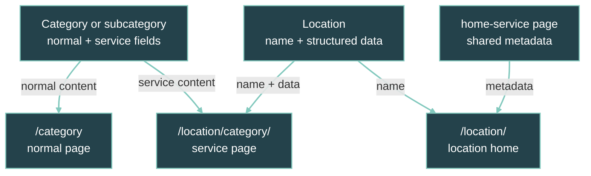

# Enquiry Admin Panel

## Admin Panel Credentials

| Username | Password   | Hash                                                           |
| -------- | ---------- | -------------------------------------------------------------- |
| admin    | Behoof$007 | `$2y$10$V25Xm8Qr8TZmGWyKT0Yy3uoRZYxn/IFUaUs0PHUTyQhgStNySYSh.` |

> **Note:** Change the default credentials after your first login for security.

---

## Project Setup

1. Clone the repository:

   ```bash
   git clone https://github.com/Behoof-Multimedia/enquiry-adminpanel.git
   ```

2. Install dependencies:

   ```bash
   composer install
   ```

3. Configure environment:

   ```bash
   mv .env.sample .env
   ```

   - Set `DB_DATABASE` in `.env`
   - Set site name and directory if needed (e.g., if URL is `http://localhost/behoof`, directory is `behoof`)

---

## Existing database migration

`setup-db.sql` is for a fresh database. For an existing MariaDB database, back it up and run the following SQL in your database client before deploying the PHP changes:

```sql
-- Upgrade an existing MariaDB database to the current template schema.
-- Run before deploying the PHP changes; ADD COLUMN IF NOT EXISTS makes reruns safe.
-- Existing rows in retained tables are preserved. The legacy service-area table is left intact.

ALTER TABLE `tbl_location`
  ADD COLUMN IF NOT EXISTS `data` JSON NULL AFTER `url`;

ALTER TABLE `tbl_product_category`
  ADD COLUMN IF NOT EXISTS `heading` VARCHAR(255) NULL AFTER `url`,
  ADD COLUMN IF NOT EXISTS `service_heading` VARCHAR(255) NULL AFTER `heading`,
  ADD COLUMN IF NOT EXISTS `service_meta_title` VARCHAR(255) NULL AFTER `service_heading`,
  ADD COLUMN IF NOT EXISTS `service_meta_keyword` VARCHAR(500) NULL AFTER `service_meta_title`,
  ADD COLUMN IF NOT EXISTS `service_meta_desc` VARCHAR(255) NULL AFTER `service_meta_keyword`,
  ADD COLUMN IF NOT EXISTS `service_description` MEDIUMTEXT NULL AFTER `service_meta_desc`,
  ADD COLUMN IF NOT EXISTS `faqs` JSON NULL AFTER `service_description`,
  ADD COLUMN IF NOT EXISTS `service_faqs` JSON NULL AFTER `faqs`,
  ADD COLUMN IF NOT EXISTS `unit` VARCHAR(3) NOT NULL DEFAULT 'C62' AFTER `discounted_price`;

-- Older installations may lack these product flags. Keep their setup-db.sql order.
ALTER TABLE `tbl_product`
  ADD COLUMN IF NOT EXISTS `feature` TINYINT(4) NOT NULL DEFAULT 0 AFTER `gallery`,
  ADD COLUMN IF NOT EXISTS `status` TINYINT(4) NOT NULL DEFAULT 0 AFTER `feature`;

ALTER TABLE `tbl_config`
  ADD COLUMN IF NOT EXISTS `tiktok` VARCHAR(255) DEFAULT NULL AFTER `youtube`;

```

The statements can be rerun. Existing location descriptions remain in the legacy `description` column but are no longer used; the new editor stores structured values in `data`. Existing values in retained tables are preserved; missing category `unit` values default to `C62` (piece/unit). `tbl_product.feature` and `tbl_product.status` and `tbl_config.tiktok` are added only when missing, in the same order as `setup-db.sql`. The retired `tbl_service_area_content` table is left in place for any data recovery and is no longer read by the PHP code.

After confirming the legacy data is no longer needed, remove the retired table with:

```sql
DROP TABLE IF EXISTS `tbl_service_area_content`;
```

---

## Categories, subcategories, and service areas

This repository is a **site template**. Each website supplies its own home-page sections in `home.php`; the shared code handles routing, content lookup, metadata, and the category page. A “service area” is a location (such as Albania), not another category level. A location/category page combines one location row with one category row.

### The three content records

| Record                 | Where editors manage it           | What it owns                                                                                                  |
| ---------------------- | --------------------------------- | ------------------------------------------------------------------------------------------------------------- |
| `tbl_product_category` | Admin → Products → Category       | Category and subcategory hierarchy; normal category content; separate service-area category content and FAQs. |
| `tbl_location`         | Admin → Service Areas → Locations | Location name and slug, status, and structured location data for content templates.                           |
| `tbl_page`             | Admin → Pages                     | Static-page records and the shared `home-service` metadata record used by location homepages.                 |

A subcategory is another row in `tbl_product_category`: its `parent_id` points to the parent category. Both use the same normal and service fields.



For a subcategory, replace `/category` with `/subcategory`; its page still uses its own category row. The `/location/` homepage gets its site-specific body from `home.php`.

Each location's `data` column stores JSON with `primary_commercial_hub` (a string) and `major_sub_locations`, `industrial_hubs`, and `trade_and_logistics_hubs` (arrays of names). The admin editor accepts list values as pills; type a name and press Enter or comma. In templates, use `{{location}}`, `{{location.primary_commercial_hub}}`, `{{location.major_sub_locations}}`, `{{location.industrial_hubs}}`, and `{{location.trade_and_logistics_hubs}}`. Array values expand as comma separated names. Empty or missing data fields expand to empty text.

`tbl_product` is a separate product record type. Do not confuse it with a leaf row in `tbl_product_category`: the category page currently treats a category row **without children** as a product-style page for pricing and Product schema.

### Category hierarchy and URLs

`tbl_product_category.parent_id = '0'` means a top-level category. To add a subcategory, open that parent in Admin → Products → Category and add a child; the child's `parent_id` stores the parent's UUID. The header navigation shows top-level categories and their children. `category.php` finds children by `parent_id`; if any exist it shows “Related Products” and CollectionPage schema, otherwise it shows product-style price details and Product schema. Both parents and children are rows in the **same** table and use the same editor fields.

`index.php` routes these URLs:

| URL example           | Page                                                  | Main content source                                                                                                        |
| --------------------- | ----------------------------------------------------- | -------------------------------------------------------------------------------------------------------------------------- |
| `/`                   | Site home (`home.php`)                                | Site-specific home sections; `tbl_page.url = 'home'` supplies metadata.                                                    |
| `/albania/`           | Location home (`home.php`)                            | Site-specific home sections; shared `tbl_page.url = 'home-service'` supplies metadata with location placeholders replaced. |
| `/packaging`          | Normal category or subcategory (`category.php`)       | Normal fields on the matching `tbl_product_category.url = 'packaging'` row.                                                |
| `/albania/packaging/` | Service-area category or subcategory (`category.php`) | Service fields on that **same** category row, combined with the Albania location row.                                      |
| `/about`              | Static page                                           | The route in `index.php` and its `tbl_page` record.                                                                        |

The `/location/` and `/location/category/` forms require a trailing slash; the normal `/category` form does not. Static routes are checked first. Category slugs are unique across all category rows, so subcategories have their own single-segment URLs, not `/parent/child` URLs. `home.php` and `category.php` validate that the requested location is active; `category.php` also requires an active category. Their invalid-record paths set a 404 response and redirect to the site root.

### Which category fields appear where

| Field                                                             | `/packaging`                                      | `/albania/packaging/`                                                                                                                          |
| ----------------------------------------------------------------- | ------------------------------------------------- | ---------------------------------------------------------------------------------------------------------------------------------------------- |
| `title`                                                           | Category name used in navigation and schema       | The **same** category name; `catname` expands to this value.                                                                                   |
| `heading` / `service_heading`                                     | `heading` is the H1; blank falls back to `title`. | `service_heading` is the H1 after placeholder replacement; blank falls back to `title`.                                                        |
| `meta_title`, `meta_keyword`, `meta_desc`                         | Normal page metadata.                             | Not used.                                                                                                                                      |
| `service_meta_title`, `service_meta_keyword`, `service_meta_desc` | Not used.                                         | Separate location-category metadata. A blank service meta title falls back to the service H1; blank service keywords/description remain blank. |
| `description` / `service_description`                             | `description` is the page body.                   | `service_description` is the page body; if blank, it falls back to `description`. Location placeholders expand from `tbl_location.data`.       |
| `faqs` / `service_faqs`                                           | Normal FAQ list and FAQ schema.                   | Separate service FAQ list and FAQ schema, with placeholders replaced.                                                                          |

On location home and location-category pages, `{{location}}` expands to the location title. The four `{{location.*}}` data tokens expand to the values described above; list values are joined with comma and space. `catname` still expands to the category title on location-category pages. These replacements apply to service heading, metadata, description, and service FAQs. Normal category content is not templated this way. FAQ lists are JSON arrays of `{ "question": "...", "answer": "..." }`; the admin editor adds/removes pairs and the storefront renders them as `<details>` accordions. FAQPage schema is emitted only when complete FAQs are displayed.

Each normal and location-category URL has its own canonical link. Giving pages different canonicals does **not** make their content unique: editors should write category-specific service copy and provide useful location data for tokens used on those pages. The retired `tbl_service_area_content` table is not read by the application.

### Location homepages versus location-category pages

For `/albania/`, `include/header_config.php` selects the `home-service` row from `tbl_page`. `home.php` replaces location placeholders in its meta title, keywords, description, page title, and page description, then outputs a self-canonical `/albania/` URL and location-aware schema. The starter `home.php` does not print a body section after the shared header: each website adds its own homepage sections there.

When `home.php` is handling a location URL, the route slug is available as `$location`, the location's display name as `$location_title`, and the decoded structured values as `$location_data`. These variables are in scope in the site-specific section added between the shared header and footer. Escape values before writing them into HTML:

```php
<?php if (isset($location)): ?>
  <h1><?= htmlspecialchars($location_title, ENT_QUOTES, 'UTF-8') ?></h1>
  <?php
  $commercialHub = $location_data['primary_commercial_hub'] ?? '';
  if (is_scalar($commercialHub) && trim((string) $commercialHub) !== ''):
  ?>
    <p>Serving <?= htmlspecialchars(trim((string) $commercialHub), ENT_QUOTES, 'UTF-8') ?></p>
  <?php endif; ?>
<?php endif; ?>
```

Use the `{{location}}` and `{{location.*}}` placeholders instead when the content comes from `tbl_page` or category fields. On `/location/`, `home.php` expands them in the shared `home-service` metadata and page title/description. On `/location/category/`, `category.php` expands them in that category row's service heading, metadata, description, and service FAQs; `catname` is also available there for the category title. The location's structured keys and list formatting are documented above.

For `/albania/packaging/`, `category.php` does **not** use the `home-service` row for its final metadata. It reads the category's separate service fields and expands location placeholders from `tbl_location.data`. Editing `home-service` changes location-homepage metadata but not location-category content. Editing a location's data affects its location home and category pages wherever those placeholders are used.

### Editing and publishing checklist

1. Create or edit top-level categories under Admin → Products → Category. Open a parent to add children. Set a unique URL slug and fill the **Category page** section for `/category`.
2. Fill the separate **Service-area category page** section on each category or child that should have `/location/category/` content. Use `{{location}}` and the `{{location.*}}` tokens where location data should appear. Its H1, metadata, description, and FAQs are saved on the category row, not in `tbl_page`.
3. Create active locations under Admin → Service Areas → Locations and fill their structured data as needed. Fill `tbl_page.url = 'home-service'` through Admin → Pages for shared location-homepage metadata, then build that site's own homepage body section in `home.php`.
4. Check one normal category, one child category, one location homepage, and one location-category page. Inspect their H1, meta tags, canonical, description, and FAQ schema. Publishing many pages with only a location-name swap can still produce near-duplicate pages.

The sitemap lists active locations when a `home-service` row exists. It lists location-category combinations only when that row exists and an active category has a non-empty `service_description`; the combinations use active locations and those populated categories. Sitemap presence is a publishing signal, not a content-quality check.

---

## Form Features

### CAPTCHA Implementation

**1. Generate Form ID:**

```php
<?php $formId = uniqid('form_', true); ?>
```

**2. Form Structure:**

```php
<form action="<?= SITE_URL ?>/mail.php" method="POST" class="contact-form" data-form-id="<?= $formId ?>">
    <!-- Your form fields -->

    <!-- CAPTCHA -->
    <div class="mt-4">
        <label>Verification Code</label>
        <div class="flex items-center gap-2 mb-4">
            <input type="text" name="captcha_code" required class="captcha-input" placeholder="Enter code">
            /captcha.php?generate=1&form_id=<?= $formId ?>"
                 class="captcha-image cursor-pointer" data-form-id="<?= $formId ?>" style="height: 50px;">
            <button type="button" class="captcha-refresh-btn">↻</button>
        </div>
        <input type="hidden" name="captcha_form_id" value="<?= $formId ?>">
        <button type="submit">Submit</button>
    </div>
</form>
```

**3. JavaScript:** Include `assets/js/contact-form.js` (auto-handles refresh)

**4. Validation:** Server-side in `mail.php` (validates against session, clears after validation)

**API Endpoints:**

- `GET /captcha.php?generate=1&form_id={formId}` - Generate image
- `GET /captcha.php?validate=1&form_id={formId}&code={input}` - Validate (returns JSON)

### International Phone Number Field

**1. Include Libraries** (in `components/header.php`):

```html
<link
  rel="stylesheet"
  href="https://cdnjs.cloudflare.com/ajax/libs/intl-tel-input/24.6.0/build/css/intlTelInput.css"
/>
<script src="https://cdnjs.cloudflare.com/ajax/libs/intl-tel-input/24.6.0/build/js/intlTelInput.min.js"></script>
<script src="<?= SITE_URL ?>/assets/js/contact-form.js"></script>
```

**2. HTML Structure:**

```php
<div>
    <input type="tel" name="phone" class="phone" placeholder="Phone Number">
    <span class="error-msg text-red-500 text-sm"></span>
    <span class="valid-msg text-green-500 text-sm"></span>
</div>
<input type="hidden" name="location"> <!-- Auto-populated with country name -->
```

**Features:**

- Auto-detects country via IP (ipapi.co)
- Validates on form submission
- Formats with country code
- Shows validation messages
- Populates `location` field with country name

**Validation:** Server-side in `mail.php` using `sanitizePhoneNumber()`

---

## Admin Panel (CMS)

The admin panel is a content management system that follows a consistent pattern for managing database tables. Each module consists of two main files: a management page and an editor page.

### Structure Pattern

**Management Page** (e.g., `adminpanel/page.php`):

- Lists all records from a table
- Handles POST requests for add/edit/delete operations
- Includes `components/manage.php` for table display
- Includes `components/quick-process.php` for delete/approve actions

**Editor Page** (e.g., `adminpanel/page-editor.php`):

- Form for adding/editing records
- Handles form submission (redirects to management page)
- Includes media gallery modal for image selection

### Configuration Variables

Each management page defines these variables:

```php
$page_title = "Page";           // Page title
$page_subtitle = "Management";  // Subtitle
$table = "tbl_page";            // Database table name
$id_col = 'id';                 // Primary key column
$id_type = "i";                 // Parameter type (i=int, s=string)

// Table columns to display
$tableContent = [
    "Title" => "title",
    "URL" => "url",
    "Status" => "boolean status",  // Special: displays icon
];

// Available actions
$actions = [
    'approve' => false,  // Show approve button
    'add' => true,       // Show add button
    'edit' => true,      // Show edit button
    'delete' => true     // Show delete button
];

$editor_url = "page-editor.php";  // Editor page URL
```

### Media Gallery Integration

**1. Include Media Gallery Modal:**

```php
<?php include("components/media-gallery-modal.php"); ?>
<script src="assets/js/media-gallery.js"></script>
```

**2. Add Image Selection Button:**

```php
<input type="hidden" name="image" value="<?= $data['image'] ?? ''; ?>" id='feature-image-input'>
<button type="button" class="btn btn-secondary btn-sm openMediaModal"
    data-bs-toggle="modal"
    data-bs-target="#mediaSelectionModal"
    data-type="image"           // Filter: image, pdf, video, csv, all
    data-selection="single"     // single or multiple
    group-id='feature-image'>   // Unique ID for this field
    Select Image
</button>
```

**3. Display Selected Image:**

```php
<?php if (!empty($data['image'])): ?>
    '
         class='full-width'
         id='feature-image-img'>
<?php endif; ?>
```

**Media Gallery Features:**

- Upload multiple files (images, PDFs, videos, CSV)
- Images auto-converted to WebP format (max 1200px width)
- Bulk select and delete
- Alt text management
- Filter by file type

### Displaying Images in Frontend

Use this pattern to display images with proper alt text:

```php
image ?>"
     class="content-image"
     alt="<?= isset($respage->image) && !empty($respage->image)
                 ? $getdata->fetchAltText($respage->image)
                 : htmlspecialchars($respage->title, ENT_QUOTES) ?>">
```

**How it works:**

- `media_folder` - Constant for upload directory path
- `$getdata->fetchAltText($image)` - Fetches alt text from `tbl_media.description`
- Falls back to record title if no alt text exists
- Uses `htmlspecialchars()` for security

### Quick Process Component

The `components/quick-process.php` handles:

- **Delete:** Single record deletion via AJAX
- **Approve:** Status update (0 → 1)
- **Bulk Delete:** Multiple record deletion

Actions are triggered from the management table with confirmation dialogs.

### Creating a New Module

1. **Create management page** (`adminpanel/your-module.php`):

   ```php
   include("components/config-header.php");
   $page_title = "Your Module";
   $table = "tbl_your_table";
   $tableContent = ["Column" => "column_name"];
   $actions = ['add' => true, 'edit' => true, 'delete' => true];
   $editor_url = "your-module-editor.php";
   include("components/manage.php");
   ```

2. **Create editor page** (`adminpanel/your-module-editor.php`):

   ```php
   include("components/config-header.php");
   include("components/header.php");
   // Form with fields matching table columns
   // Include media gallery modal if needed
   include("components/media-gallery-modal.php");
   ```

3. **Handle POST in management page:**
   ```php
   if ($_SERVER["REQUEST_METHOD"] == "POST") {
       include('components/quick-process.php');
       // Your add/edit logic here
   }
   ```

---

## Quick Reference

### Required Form Classes

- Form: `class="contact-form"`
- Phone input: `class="phone"`
- Error message: `class="error-msg"`
- Success message: `class="valid-msg"`
- CAPTCHA image: `class="captcha-image"`
- CAPTCHA refresh: `class="captcha-refresh-btn"`

### Form Submission

- Action: `<?= SITE_URL ?>/mail.php`
- Method: `POST`
- Required fields: `name`, `email`, `message`, `captcha_code`, `captcha_form_id`
- Optional: `phone`, `location`

### Key Files

**Frontend:**

- `index.php` - Router
- `category.php` - Category page handler
- `captcha.php` - CAPTCHA generation/validation
- `mail.php` - Form processing
- `include/header_config.php` - SEO metadata fetching
- `assets/js/contact-form.js` - Form JavaScript

**Admin Panel:**

- `adminpanel/page.php` - Example management page
- `adminpanel/page-editor.php` - Example editor page
- `adminpanel/media-gallery.php` - Media library
- `adminpanel/components/manage.php` - Table display component
- `adminpanel/components/quick-process.php` - Delete/approve handler
- `adminpanel/components/media-gallery-modal.php` - Media selection modal

---

For further configuration or troubleshooting, refer to the project documentation or contact the maintainer.
